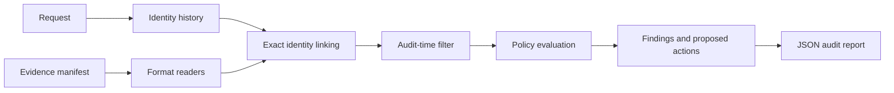

# Traceveil

**Find the data that deletion workflows miss.**

Traceveil is a local, evidence-first toolkit for auditing personal-data deletion across distributed systems. It links a request to current and historical identifiers, inspects supplied evidence at a point in time, applies a data-retention policy, and produces a reviewable report with findings and proposed follow-up actions.

It is designed as a personal project and a reusable starting point for privacy engineering teams. It does not call an LLM or send your evidence over the network.

## Why Traceveil?

A deletion job can succeed in one service while a replica, search index, export, support attachment, backup, or enabled sync still contains the same data. A workflow status is a claim about work performed; it is not proof of the resulting state. Traceveil keeps those concerns separate by recording what each source says, when that source was captured, which identifier linked it to a subject, and what the configured policy requires.

## What it does

- Reads requests, identity history, policy rules, and an evidence manifest from a workspace directory.
- Ingests CSV, TSV, JSON, JSONL, SQLite-compatible SQL, plain text, key-value logs, and newline-delimited JSON logs.
- Tries optional PDF text extraction with `pypdf` and screenshot OCR with `Pillow`, `pytesseract`, and the Tesseract executable.
- Uses exact identifier matching with provenance; shared identifiers and low-confidence identity links are not treated as proof.
- Filters out evidence captured or observed after a request's audit timestamp.
- Applies per-category `DELETE`, `REDACT`, `ANONYMIZE`, and `RETAIN` rules, and flags enabled data flows and allowed restore paths.
- Emits a deterministic JSON report with evidence references, findings, remediation suggestions, verification checks, and uncertainty notes.
- Runs locally with Python's standard library; optional extractors are extra dependencies.

## Audit pipeline



The engine records why each resource matched, which source described its state, and which policy determined its treatment. Ambiguous or missing links remain visible as uncertainty.

## Quick start

Python 3.10 or newer is required.

```bash
python -m venv .venv
```

Activate the environment, then install Traceveil in editable mode:

```bash
# macOS / Linux
source .venv/bin/activate

# Windows PowerShell
.venv\Scripts\Activate.ps1

python -m pip install -e .
```

Run the included synthetic workspace:

```bash
traceveil audit --workspace examples/minimal
```

Or run it without installing the console command:

```bash
python -m traceveil audit --workspace examples/minimal
```

The report is written to `examples/minimal/traceveil-report.json`. Choose another location with `--output`:

```bash
python -m traceveil audit \
  --workspace examples/minimal \
  --output build/review.json
```

Use `--verbose` to display parser warnings. Missing optional PDF or OCR tools are reported and the audit continues with other sources.

## Workspace format

A workspace is a directory with four CSV control files and the evidence paths they reference:

```text
workspace/
├── requests.csv
├── identities.csv
├── policies.csv
├── manifest.csv
└── evidence/
    ├── records.jsonl
    └── ...
```

### `requests.csv`

| Column | Purpose |
| --- | --- |
| `request_id` | Unique request identifier |
| `subject_id` | Stable internal subject key |
| `requested_at` | Time the request was received (ISO 8601) |
| `audit_at` | Point-in-time cutoff (ISO 8601) |
| `authorization` | `DELETE` to authorize a deletion audit; other values produce `NOT_APPLICABLE` |
| `request_text` | Human-readable request context for reviewers |

### `identities.csv`

| Column | Purpose |
| --- | --- |
| `subject_id` | Stable internal key that owns the identity value |
| `identifier_type` | For example `email`, `phone`, `email_hash`, or `subject_id` |
| `identifier_value` | Exact identifier value; never fuzzy-matched |
| `valid_from`, `valid_to` | Optional ISO 8601 validity window |
| `confidence` | Accepts `high`, `verified`, or `authoritative` for automatic matching |
| `source_ref` | Provenance label for the identity assertion |

### `policies.csv`

| Column | Purpose |
| --- | --- |
| `category` | Evidence record category |
| `required_action` | `DELETE`, `REDACT`, `ANONYMIZE`, or `RETAIN` |
| `allowed_fields` | Semicolon-separated field names permitted to remain |

### `manifest.csv`

| Column | Purpose |
| --- | --- |
| `evidence_id` | Stable citation included in the report |
| `path` | Evidence path relative to the workspace |
| `system_id` | Source system label used when a record has none |
| `captured_at` | ISO 8601 capture time; later captures are excluded |

Evidence records should include a `resource_id` (or `id`), `category`, and subject identifiers such as `subject_id`, `email`, or `phone`. Optional fields such as `state`, `enabled`, `restore_allowed`, `observed_at`, `event_time`, and `updated_at` help Traceveil reconstruct state and risk. JSON can nest the record in a larger document; SQL rows may store a JSON string in a column.

See [`examples/minimal`](examples/minimal) for a complete synthetic workspace and [`PROBLEM_STATEMENT.md`](PROBLEM_STATEMENT.md) for the project contract.

## Reading the report

Each request receives one decision:

- **`CLEAR`** — linked records were observed and all discovered records satisfy the configured treatment.
- **`ACTION_REQUIRED`** — evidence shows a policy violation or a process that can recreate data.
- **`NOT_APPLICABLE`** — the request's authorization field does not authorize deletion.
- **`INDETERMINATE`** — evidence is missing, ambiguous, unmapped, or insufficient to support a conclusion.

The report separates `findings`, `remediation`, and `verification`. A remediation is a proposal; Traceveil never executes deletion, redaction, sync changes, or restore blocks. `uncertainty` calls out missing policy mappings and lack of linked evidence instead of treating silence as proof.

## Trust boundaries and limitations

Traceveil is a deterministic audit aid, not a legal determination or a guarantee that every system has been searched. Its conclusions are only as complete as the workspace manifest, source evidence, identity history, and policy supplied by the operator. Exact matching avoids risky fuzzy attribution but can miss transformed, tokenized, or unrecorded identifiers. Shared identifiers are excluded from automatic matches. For production use, review the report, validate source coverage, define your own authorization and retention policy, and protect the workspace because evidence may contain personal data.

PDF and image extraction are best-effort optional capabilities. Install the relevant Python extras; image OCR also requires a separately installed Tesseract executable. Extraction warnings mean the relevant artifact may not have contributed evidence.

## Project layout

```text
src/traceveil/       CLI, evidence readers, identity matching, and audit engine
examples/minimal/    Synthetic end-to-end workspace
PROBLEM_STATEMENT.md Generic product problem and output contract
```

## Development

Install optional extractors as needed:

```bash
python -m pip install -e ".[pdf,ocr]"
```

The project has no required third-party runtime dependencies. Keep personal workspaces, generated reports, secrets, and real customer data out of version control. See [`.gitignore`](.gitignore).

## License

MIT. See [`LICENSE`](LICENSE).

